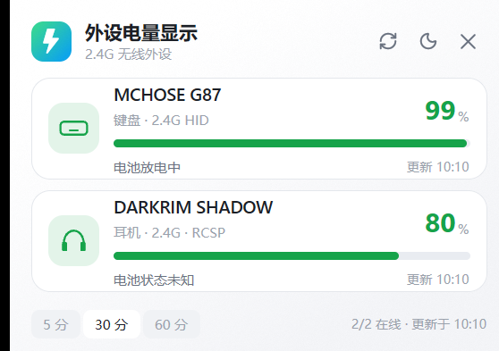
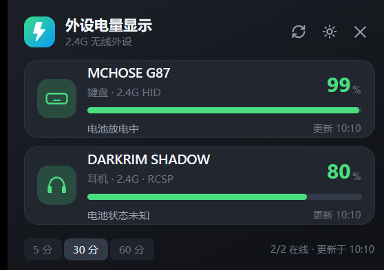

# 外设电量显示

Windows 上的 2.4G 无线外设电量面板。托盘常驻，点开看电量，不需要装厂商驱动。

产物是 `外设电量显示.exe`（包名仍是 `peripheral-battery`，Rust 侧标识符保持 ASCII）。

| 亮色（默认） | 暗色 |
|---|---|
|  |  |

## 支持设备

| 设备 | VID:PID | 协议 |
|---|---|---|
| 迈从 MCHOSE G87（2.4G） | `41E4:2001` | 20 字节帧 / `HID SET_REPORT` / 命令 `0x4A` |
| DARKRIM SHADOW（2.4G，杰理方案） | `3654:6901` | 65 字节 RCSP 帧 / interrupt OUT / TLV + CRC16 |

两种协议的实测帧格式、CRC 算法和踩过的坑都写在 [`docs/PROTOCOLS.md`](docs/PROTOCOLS.md)。
里面的报文都是真机抓的，不是推测。

## 行为

- 每次从托盘唤出都回到主屏工作区正中（拖到别处也不会「记住」），可以按住页眉拖动；**是个普通窗口**，任务栏有图标，点到别处不会自己消失
- 面板默认亮色，右上角的月亮/太阳一键切换，选择记在注册表
- 托盘图标是固定的「渐变方块 + 白闪电」，不随电量变数字也不变色；电量低于 20% 时闪电转红
- 悬停托盘图标时，提示框按行列出每台设备的电量（最多 6 行，多的折成「…另有 N 台」）
- 左键托盘图标切换显示/收起；`✕`、`Alt+F4`、任务栏右键「关闭」都只收进托盘，不退出进程；右键菜单贴着图标弹出，条目：显示、自启（勾选 = 开机自动启动）、三档刷新间隔（单选圆点）、退出
- 刷新间隔完全听用户的选择（托盘菜单或面板底部胶囊，同一份状态），默认 30 分钟；面板打开/收起只影响立即刷新一次，不会偷偷换节奏
- **只允许一个实例**：再启动一次不会多开，只会把已经在跑的那个面板叫出来；Explorer 重启（更新、外壳崩溃、安全软件改启动项后重启资源管理器）后托盘图标会自动重新挂上
- 读不到时区分三种状态：**设备休眠中**（收不到应答）、**未检测到设备**（插都没插）、**读取失败**（设备在但 IO 出错，不再伪装成休眠）；协议里不带充电位的设备（如 DARKRIM 耳机）显示**电池状态未知**，不会替你猜「放电中」

## 结构

```
src/                 # 库：协议与 IO，不依赖任何 UI
  hid/               # Win32 HID 访问：枚举 / overlapped 读写
  providers/         # 每台设备一个协议实现（帧构造 + 解析是纯函数）
  provider.rs        # BatteryProvider trait
  service.rs         # 后台轮询线程 + 快照
  tray/              # Shell_NotifyIconW 托盘 + 右键菜单
    icon.rs          # 用 GDI 现画托盘图标（渐变方块 + 闪电，按 DPI 出 16/20/24/32）
  autostart.rs       # HKCU Run 键
  diag.rs            # 落盘日志（%LOCALAPPDATA%\PeripheralBattery\log.txt）
  bin/probe.rs       # 协议探测工具（接新设备时用）
  bin/status.rs      # 命令行读数

app/                 # 界面：gpui-kit 0.9.1（默认 feature 关掉了 component/assets）
  build.rs           # embed-resource：把 app.rc（图标 + 版本信息）编进 exe
  assets/app.ico     # 九档图标，由 examples/gen_icon.rs 生成
  assets/icons/      # 页眉与品牌标用的 SVG（Lucide MIT + Bootstrap MIT）
  examples/          # gen_icon（构建期出 ICO）
  src/panel.rs       # 主面板、托盘联动、收进托盘、按行数自适应高度
  src/icons.rs       # 页眉四个图标：Lucide SVG（月亮 / 太阳 / 刷新 / 关闭）+ 品牌闪电
  src/device.rs      # 一行设备：图标、名称、电量条、状态
  src/theme.rs       # 尺寸常量 + 亮/暗两套配色
  src/chrome.rs      # DWM 圆角、工具窗口样式、显隐、带锚点的窗口缩放
```

界面与 IO 完全解耦：轮询线程只顾着把结果写进一把锁，UI 每 150ms 看一眼版本号。
设备休眠导致的 900ms 超时不会卡住渲染。

## 界面尺寸

窗口宽度固定 **372** 逻辑像素，高度**由设备行数算出来**（`theme::panel_height`）：

| 设备数 | 高度（逻辑像素） | 150% 缩放下实际像素 |
|---|---|---|
| 1 | 190 | 372 × 285 |
| 2 | 274 | 558 × 411 |
| 3 | 358 | 558 × 537 |
| 4 | 442 | 558 × 663 |
| 5（上限） | 526 | 558 × 789 |

每多一行加 84（行高 76 + 间距 8）。行数变化时窗口自己长高，**右下角钉住不动**，
并夹进屏幕工作区，不会长到屏幕外面去。超过 5 行不再变高，列表改成滚动，
页脚和页眉始终可见。

新增设备的完整流程是「写一个 provider + 在 `providers::defaults()` 里注册」——
布局不用动，面板会自己多出一行。

## 电量条

不是贴图也不用量图：电量条是一条底槽 + 一个按百分比取相对宽度的填充块
（`app/src/device.rs` 的 `bar`）。用相对宽度而不是算好的像素值，是为了让 100%
正好铺满、0% 一点不剩 —— 早期按「窗口宽 - 内边距」估算宽度，漏算了左边图标和间距，
90% 以上就冲出卡片右边。

色号按电量分三档（≥50% 绿 / ≥20% 橙 / 更低红），读不到设备时用灰色而不是红色 ——
「没电」和「读不到」不是一回事。

## 构建

```bash
cargo build -p peripheral-battery-app             # 日常调试，几秒增量
cargo build --release -p peripheral-battery-app   # 出 target/release/外设电量显示.exe（~11 MB）
cargo build --profile dist -p peripheral-battery-app  # 出包用（整程序 LTO，更慢）
cargo test --workspace                            # 协议字节级 + 布局纯函数单测
cargo run --example gen_icon -p peripheral-battery-app   # 重新生成 app/assets/app.ico
```

`app/build.rs` 用 `embed-resource` 把 `app/assets/app.rc`（图标 + VERSIONINFO）编进 exe，
找不到 `rc.exe` 时会在 Windows SDK / Visual Studio 目录里自己找；换机器出图标版本时
只需要保证装着 Windows SDK。

两档 profile 是刻意分开的：`release` 不 LTO、并行代码生成，改一行只重编本 crate；
`dist` 才开 `lto = "fat"` + `codegen-units = 1` + `opt-level = "s"` 挤体积。
体积优化放在最后一步做，不拖慢日常编译。

只有两个直接依赖：`windows-sys` 和 `thiserror`；界面侧是 `gpui-kit`。
不依赖 hidapi —— 自己封的 `CreateFileW` + overlapped I/O，读写都带超时。

### 跑在哪儿

把 `target/release/外设电量显示.exe` 复制到普通目录再用，比如：

```bat
mkdir "%LOCALAPPDATA%\Programs\PeripheralBattery"
copy "target\release\外设电量显示.exe" "%LOCALAPPDATA%\Programs\PeripheralBattery\"
```

从受限位置（沙箱、调试器、某些加了 ACL 的工程目录）启动时，进程会拿到受限令牌，
连 `HKCU` 都只能读 —— 表现就是开机自启报「错误码 5」，而同一个系统上 `reg add` 却正常。
把 exe 挪出去就好了，程序本身不需要管理员权限。

## 调试

```bash
cargo run --bin status      # 命令行打印电量，判断问题在协议层还是 UI 层
cargo run --bin probe -- list
cargo run --bin probe -- listen --vid 3654 --secs 15
cargo run --bin probe -- send --vid 3654 --pid 6901 --usage-page FF02 --hex "00 FE ..." --mode write
```

运行日志在 `%LOCALAPPDATA%\PeripheralBattery\log.txt`：托盘注册结果、每轮轮询读数都在里面。

## 体积与内存

四档 profile 的实测（同一份代码，干净构建）：

| profile | exe | 说明 |
|---|---|---|
| `release` | 12.2 MB | 日常开发：不 LTO、并行代码生成，改一行只重编本 crate |
| `dist` | 8.1 MB | 出包：`lto = "fat"` + `codegen-units = 1` + `opt-level = "s"` + `strip = "symbols"` |
| `dist-tiny` | 6.4 MB | 再加 `panic = "abort"` |
| `dist-min` | 5.7 MB | 再加 `opt-level = "z"` |

`dist-min` 比 `release` 小 53%。代价有两个：`opt-level = "z"` 只照顾体积、不在乎速度；
`panic = "abort"` 让 panic 直接结束进程（不会被 `catch_unwind` 接住后再画下一帧）。
面板是常驻小工具、渲染量很小，这两个代价实测都感觉不到。

运行时内存（`dist-tiny`，150% DPI，2 台设备）：**工作集 62 MB、私有 73 MB**，
一分钟采样纹丝不动（无泄漏）。其中我们自己的堆分配只有 KB 级 —— 剩下的是
Direct3D 设备/交换链、字形图集与 gpui 的运行时，换 profile 不影响这一项。

自己的代码不到 100 KB，剩下全是 gpui 那条依赖链（`cargo tree` 数得到 295 个 crate）。

砍掉的那 7.5 MB 来自一处配置：`gpui-kit` 的默认 feature 会带进 `gpui-component` 和
`gpui-kit-assets`（一整套控件库 + 资源），而面板全是手写的 div 和 canvas，一个组件都没用：

```toml
gpui-kit = { version = "0.9.1", default-features = false }
```

`gpui_kit::init()` 在关掉 component 后会自动退化成 `gpui_base::init()`，代码一行没改。

| 占地方的来源 | 谁引进来的 | 我们直接用了吗 |
|---|---|---|
| `rustybuzz` + `fontdb` | 文字整形、字体枚举 | 是，排版离不了 |
| `lyon` 全家 | 路径三角化 | 间接用，窗口绘制底层仍走它 |
| `resvg` + `usvg` | SVG 光栅化 | 是，页眉图标按像素覆盖率渲染，所以细线不锯齿 |
| `accesskit` 全家 | 无障碍树 | 否 |
| `image`（含 webp） | 图片解码 | 否 |

真要再往下压，只有两条路：把页眉图标改成构建期光栅化的 PNG（让 LTO 有机会把
`resvg`/`usvg`/`tiny-skia`/`image` 整条链当成死代码丢掉，估计再省 1–2 MB），
或者不用 gpui —— 后者等于重写，不值得。

## 已知限制

- 键盘闲置几分钟后接收器会休眠，此时代码里连问三次也拿不到应答，面板显示「设备休眠中」——
  按一下键盘就恢复。参考实现（Voltide）的行为一致。
- 托盘右键菜单是系统原生菜单，跟随**系统**主题（面板选了暗色，菜单仍是系统那套配色）。
- 主题只有亮/暗两态，不跟随系统 —— 面板每次出现的样子应当稳定可预期。
- 任务栏图标用的是 exe 里嵌的图标（资源号 1），进程另外声明了 AppUserModelID，任务栏与开始菜单归到同一个应用身份。
- 只适配了上面两台设备；别的型号需要先跑 `probe` 逆出帧格式，再写一个 provider。

## 第三方资源

页眉图标是 SVG 资源，托盘与 exe 图标是同一形状的代码光栅化版本：

| 资源 | 来源 | 许可 |
|---|---|---|
| `moon.svg` `sun.svg` `refresh.svg` `close.svg` | [Lucide](https://lucide.dev)（`close.svg` 的 X 加宽到 13 单位，描边收细到 1.6） | ISC |
| `bolt.svg` | [Bootstrap Icons](https://icons.getbootstrap.com) 的 `lightning-fill` | MIT |

字体使用系统自带的 Microsoft YaHei UI / Segoe UI，不随仓库分发。
